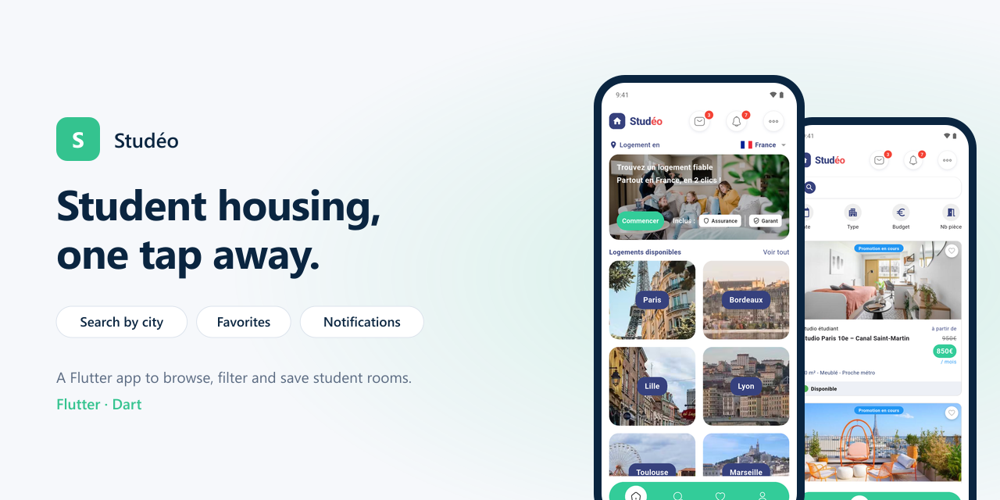
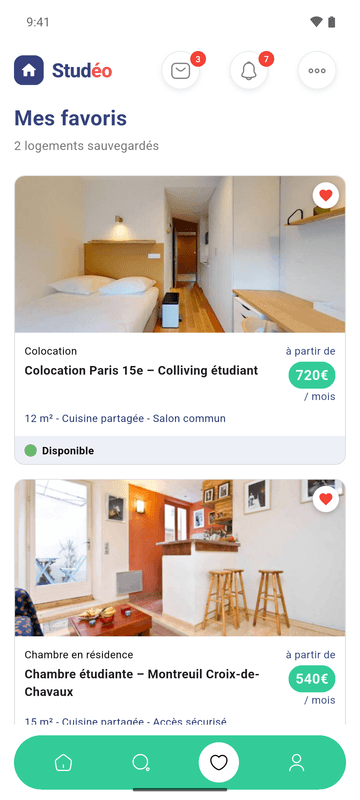

# Studéo

<p align="center"></p>


A Flutter app to find student housing: browse cities, filter rooms, save favorites and follow notifications.

## Screens

<p align="center"></p>

| Home | Search | Favorites | Profile |
|:---:|:---:|:---:|:---:|
|  |  |  |  |

## Features

- **Home**: housing by city (Paris, Bordeaux, Lille, Lyon…) and a featured offer with insurance and guarantor included.
- **Search**: room listings with filters by type, budget and number of rooms, promotions and availability.
- **Favorites**: rooms saved for later.
- **Notifications**: messages and alerts with unread counters.
- **Profile**: account and preferences.

## Tech stack

- Flutter, Dart
- [iconsax](https://pub.dev/packages/iconsax), [ionicons](https://pub.dev/packages/ionicons)

```
lib/
├── constants/   colors, text styles
├── data/        sample data: cities, locations, rooms, notifications
├── screens/     home, search, favorites, notifications, profile
└── ui/          reusable widgets
```

## Getting started

```bash
flutter pub get
flutter run
```

## Status and roadmap

The app runs on local sample data (`lib/data/`). Next steps:

- [ ] Backend for listings and accounts
- [ ] Booking and payment flow
- [ ] In-app messaging with landlords

## Author

**Dissang Kevin** · Mobile AI Engineer
[Portfolio](https://dissangkevin.work) · [GitHub](https://github.com/kteken10)
